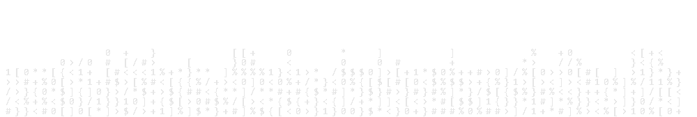

<h1 align="center">Guilherme Trevisan</h1>

Software developer · São Paulo, Brazil

  <a href="https://www.linkedin.com/in/trevisanz/">LinkedIn</a> &nbsp; · &nbsp;
  <a href="">Portifolio</a>

 

### Experience

**[Hiperion](https://hiperionassessoriacontabil.com.br/pt)** &nbsp; Software development & digital transformation  
**[Fismed](https://www.fismed.com.br/)** &nbsp; Front-end development · Angular  
**[Markab](https://www.markabpay.com/)** &nbsp; Mobile development · React Native

### Tools I work with

  

 

SOFTWARE ENGINEERING @ FIAP &nbsp; / &nbsp; IT STUDIES @ AIT, AUSTRALIA

